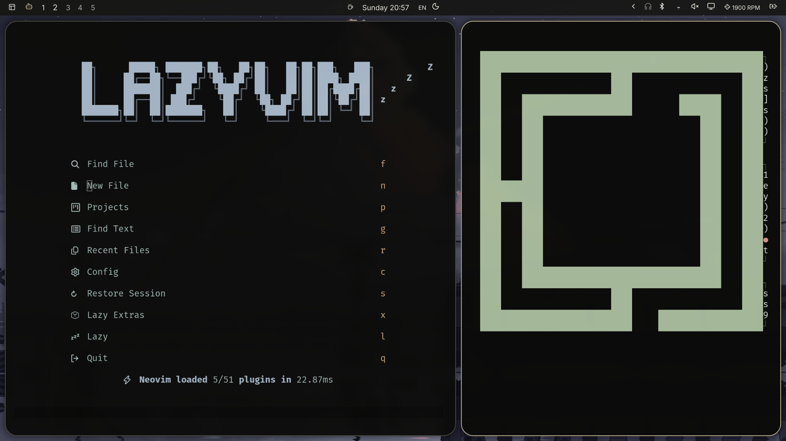
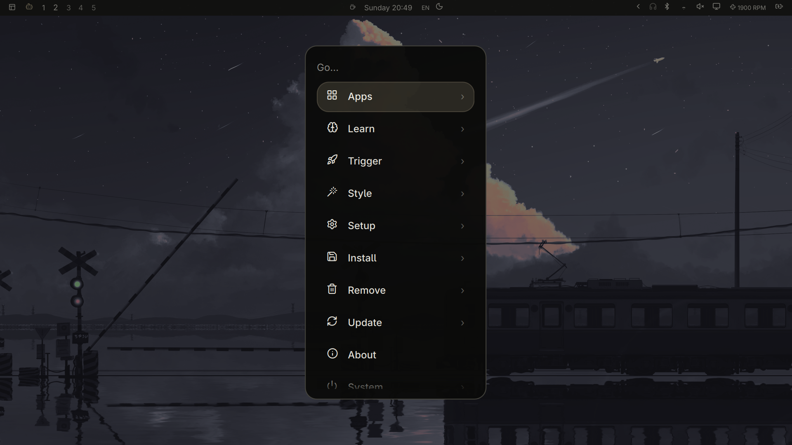
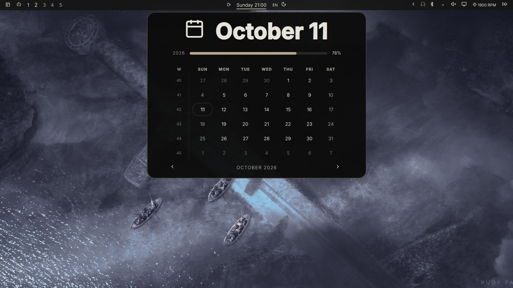

# Warm Glass

A warm dark Omarchy theme: charcoal surfaces, ivory text, muted gold accents and soft transparency.
Inspired by [this desktop](https://x.com/icanberk/status/2109031477484937571).



## Install

For **Omarchy 4.0.0.alpha with the Quickshell shell**. Choose one option for a fresh installation.
Both include the 18 selected wallpapers. Existing Warm Glass setups are preserved: the scripts
stop rather than overwrite them.

Download once:

```sh
git clone https://github.com/Ahmed-Sinkeat/omarchy-warm-glass-theme.git
cd omarchy-warm-glass-theme
```

### Simple

Colors, top bar styling and wallpapers, using Omarchy's standard theme installer:

```sh
bash install-simple.sh
```

### Full

Everything above, plus Lucide desktop icons, shared menu/popup controls, rounded windows,
warm borders, blur and shadows. This one script runs all setup steps and prints backup paths:

```sh
bash install.sh
```

The full setup keeps your current wallpaper selected. Use **Style → Background** to choose
an included wallpaper, or cycle with `omarchy theme bg next`.

<details>
<summary>Full setup requirements and behavior</summary>

Requires Python 3.11+, Python FontTools, Node.js, `patch`, Lua's `luac`, Fontconfig tools,
`g++`, `pkg-config`, Qt 6 Gui/Qml development files, `qml6`,
`/usr/lib/qt6/bin/qmllint` and Adwaita Sans. The script does not install packages.
The simple option only needs Omarchy and Git.

Full setup creates a local theme and user-owned shell plugin clones, then installs the
shared controls and Lucide icon coverage, including battery states. It refuses existing
Warm Glass theme/background directories, its icon font/config, or your personal bar clone.
Choose full directly; installing simple first creates a theme directory that full will preserve.

Existing custom plugin files can be modified after they are backed up. The setup removes the
persistent no-gaps override, reloads Hyprland and restarts the shell. Input handlers and
hardware commands are preserved. Save the printed backup paths; if a later step fails,
earlier completed steps remain installed and can be undone below.

Bar opacity is 90%; menus/panels 95%; tooltips/notifications 97%. Text and icons stay opaque.
Terminal fonts and prompts keep their current settings. Tray logos come from their applications;
file manager icons use the system's Yaru Wartybrown Dark theme. User-level shell overrides
still take precedence. Older Waybar releases are unsupported.

</details>

<details>
<summary>More screenshots</summary>





Screenshots show the full setup. See the [color palette](preview.svg).

</details>

<details>
<summary>Update an existing full setup</summary>

From an updated checkout, run the applicable helper. Both preserve backups:

```sh
python3 update-controls.py --apply
python3 update-controls.py --bar --apply
```

Switching themes changes the palette but leaves the plugin clones and font fallback installed.
The fallback also affects other applications requesting Adwaita Sans. Undo the full setup
below to remove those changes.

</details>

<details>
<summary>Undo the full setup</summary>

These instructions apply to a fresh optional installation made with the helpers in this
repository. Save any edits made after installation: restoring a backup replaces those files
with their saved versions. Keep the printed backup directories until you have finished undoing.

Set these three paths to the ones printed by the installation steps, then run the block in Bash.
If you ran later updates, restore their backups in reverse chronological order first, using the
same loop with those newer backup paths.

```bash
initial_backup="$HOME/.local/state/omarchy/warm-glass-backup-REPLACE"
controls_backup="$HOME/.local/state/omarchy/warm-glass-controls-REPLACE"
icons_backup="$HOME/.local/state/omarchy/warm-glass-controls-REPLACE"

(
  set -e
  test -f "$initial_backup/theme.name"
  test -f "$initial_backup/shell.json"
  for backup in "$icons_backup" "$controls_backup" "$initial_backup"; do
    test -f "$backup/created-plugins"
  done
  for backup in "$icons_backup" "$controls_backup"; do
    for tree in .config .local/state; do
      if [[ -d "$backup/$tree" ]]; then
        cp -a -- "$backup/$tree/." "$HOME/$tree/"
      fi
    done
  done
  cp -- "$initial_backup/shell.json" "$HOME/.config/omarchy/shell.json"
  OMARCHY_THEME_SKIP_BACKGROUND=1 omarchy theme set "$(cat "$initial_backup/theme.name")"
  omarchy theme bg set "$initial_backup"/wallpaper.*
  for backup in "$icons_backup" "$controls_backup" "$initial_backup"; do
    mkdir -p "$backup/removed-plugins"
    while IFS= read -r plugin; do
      if [[ -n "$plugin" && -d "$HOME/.config/omarchy/plugins/$plugin" ]]; then
        mv -n -- "$HOME/.config/omarchy/plugins/$plugin" "$backup/removed-plugins/"
        test ! -d "$HOME/.config/omarchy/plugins/$plugin"
      fi
    done < "$backup/created-plugins"
  done
  mkdir -p "$initial_backup/removed-fonts"
  for file in "$HOME/.local/share/fonts/warm-glass-icons.ttf" "$HOME/.config/fontconfig/conf.d/99-warm-glass-icons.conf"; do
    if [[ -f "$file" ]]; then
      mv -n -- "$file" "$initial_backup/removed-fonts/"
      test ! -f "$file"
    fi
  done
  mv -n -- "$HOME/.config/omarchy/themes/warm-glass" "$initial_backup/removed-theme"
  test ! -d "$HOME/.config/omarchy/themes/warm-glass"
  mv -n -- "$HOME/.config/omarchy/backgrounds/warm-glass" "$initial_backup/removed-backgrounds"
  test ! -d "$HOME/.config/omarchy/backgrounds/warm-glass"
  fc-cache -f "$HOME/.local/share/fonts"
  omarchy restart shell
  hyprctl reload
  hyprctl configerrors
)
```

New clones, theme files and fonts are moved into the backup directories. The saved wallpaper
remains there too, so keep the initial backup while it is selected. This preserves your files
instead of deleting them. For a standard theme-only installation, select another theme and
remove or archive `~/.config/omarchy/themes/warm-glass`; there are no companion changes to undo.


</details>

<details>
<summary>Checks and compatibility</summary>

```sh
python3 check.py
python3 update-controls.py
python3 update-controls.py --bar
```

Checks cover native theme generation, palette contrast, TOML/JSON, Lua/Bash syntax,
QML patches, unchanged input handlers, icon fonts, battery states and Unicode text.
They pass against the installed version above. A fresh desktop installation and complete
undo have not been verified end to end.

Standard Omarchy installation is also supported directly through
`omarchy theme install https://github.com/Ahmed-Sinkeat/omarchy-warm-glass-theme.git`.
Only the full script installs the optional Lua window settings and shell controls.
See [Omarchy's theme documentation](https://omarchy.org/manual/making-your-own-theme/).

</details>

## Credits and license

Theme/helper code: [MIT](LICENSE). Fonts: [Lucide ISC and Feather MIT](assets/icons/lucide/LICENSE),
with [source/build notes](assets/icons/lucide/SOURCE.md). Apple fonts and SF Symbols are not included.
Yaru icons and Adwaita Sans come from the user's system.

The included wallpapers are third-party artwork, separate from the theme's MIT license.
See [wallpaper sources and attribution status](backgrounds/README.md).
