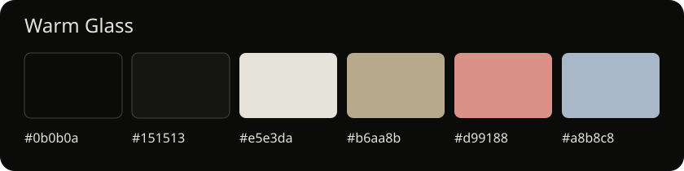

# Warm Glass

A warm dark Omarchy theme with charcoal surfaces, ivory text and muted gold accents.
Inspired by [this macOS desktop](https://x.com/icanberk/status/2109031477484937571),
adapted for Omarchy's own controls.



The preview shows the palette. A desktop screenshot is planned.

## What gets installed

| Feature | Standard theme | Optional desktop setup |
| --- | --- | --- |
| Terminal and application palette | Yes, through Omarchy's templates | Same |
| Charcoal bar, ivory text and gold accents | Yes | Same |
| Surface opacity | Bar 90%; menus/panels 95%; tooltips/notifications 97% | Same |
| File manager icon theme | Installed Yaru Wartybrown Dark | Same |
| Lucide desktop icons and Adwaita Sans text | Existing shell fonts/icons | Yes |
| Thick sliders, ivory toggles and popup pointers | Existing controls | Yes |
| 18px window corners, warm borders and soft shadows | Existing window geometry | Yes |
| Wallpapers | Keep your own | Keep your own |

Text and icons stay fully opaque. Terminal fonts and prompts keep their existing configuration.
Application tray logos come from their applications.

## Standard installation

Install directly from GitHub:

```sh
omarchy theme install https://github.com/Ahmed-Sinkeat/omarchy-warm-glass-theme.git
```

Omarchy names the installed theme `warm-glass`.
The root `colors.toml`, `shell.toml` and `icons.theme` are the native theme files.
No helper scripts run during standard installation.

Omarchy regenerates application configurations from the palette. Repository-installed themes
cannot supply Lua, terminal configuration files or VS Code extensions. The optional window
settings live in `extras/hyprland.lua` and require the explicit setup below.
See [Omarchy's theme documentation](https://omarchy.org/manual/making-your-own-theme/).

To try only the colors from a local checkout:

```sh
mkdir -p ~/.config/omarchy/themes/warm-glass
cp colors.toml shell.toml icons.theme ~/.config/omarchy/themes/warm-glass/
omarchy theme set warm-glass
```

Use an unused theme directory for the local trial. This leaves your existing shell layout and controls in place.

## Optional full desktop setup

This setup creates a user-owned theme and shell plugin clones. Run it from a separate local
checkout **before installing Warm Glass through the standard route**. It refuses to overwrite
an existing Warm Glass theme/background directory, your personal bar clone, or its icon font/config.
Existing users should keep their current setup and use the update commands below.

The helpers are tested against **Omarchy 4.0.0.alpha with the Quickshell-based shell**.
They do not support older Waybar-based releases. Patches depend on the installed shell source;
an incompatible version should fail its checks rather than install a partial patch.

Requirements in addition to Omarchy: Python 3.11+, Python FontTools, Node.js, `patch`, Lua's
`luac`, Fontconfig tools, `g++`, `pkg-config`, Qt 6 Gui/Qml development files, `qml6`, and
`/usr/lib/qt6/bin/qmllint`. Adwaita Sans must be installed. Helpers do not install dependencies.
Compilation is only for the small native font check; no additional desktop service is installed.

Clone a separate working copy, then run each step and keep the backup path it prints:

```sh
git clone https://github.com/Ahmed-Sinkeat/omarchy-warm-glass-theme.git
cd omarchy-warm-glass-theme
bash install.sh
python3 update-controls.py --apply
python3 update-controls.py --bar --apply
```

The first step installs the local theme, bar clone and icon font. The second adds the shared
controls to active panels. The third finishes icon coverage, including battery states and
popup/menu controls. Existing custom plugin files can be modified; their previous versions
are backed up before writing. Input handlers and hardware commands are preserved.

Setup preserves the current wallpaper's bytes. The controls step removes the persistent
no-gaps override so rounded corners can take effect; its previous file is backed up.
The bar step restarts the shell to clear imported QML caches. Omarchy's user-level
`~/.config/omarchy/shell.toml` overrides still take precedence over the theme.

For later updates, run only the applicable `update-controls.py` command. Switching themes
changes the palette but leaves the companion's clones and Fontconfig fallback installed.
The fallback also affects other applications requesting Adwaita Sans. Use the undo steps
below to restore the desktop completely.

## Undo the optional setup

These instructions apply to a fresh optional installation made with the helpers in this
repository. Save any edits made after installation: restoring a backup replaces those files
with their saved versions. Keep the printed backup directories until you have finished undoing.

Set these three paths to the ones printed by the installation steps, then run the block in Bash.
If you ran later updates, restore their backups in reverse chronological order first, using the
same loop with those newer backup paths.

```bash
initial_backup="$HOME/.local/state/omarchy/warm-glass-backup-REPLACE"
controls_backup="$HOME/.local/state/omarchy/warm-glass-controls-REPLACE"
icons_backup="$HOME/.local/state/omarchy/warm-glass-controls-REPLACE"

(
  set -e
  test -f "$initial_backup/theme.name"
  test -f "$initial_backup/shell.json"
  for backup in "$icons_backup" "$controls_backup" "$initial_backup"; do
    test -f "$backup/created-plugins"
  done
  for backup in "$icons_backup" "$controls_backup"; do
    for tree in .config .local/state; do
      if [[ -d "$backup/$tree" ]]; then
        cp -a -- "$backup/$tree/." "$HOME/$tree/"
      fi
    done
  done
  cp -- "$initial_backup/shell.json" "$HOME/.config/omarchy/shell.json"
  OMARCHY_THEME_SKIP_BACKGROUND=1 omarchy theme set "$(cat "$initial_backup/theme.name")"
  omarchy theme bg set "$initial_backup"/wallpaper.*
  for backup in "$icons_backup" "$controls_backup" "$initial_backup"; do
    mkdir -p "$backup/removed-plugins"
    while IFS= read -r plugin; do
      if [[ -n "$plugin" && -d "$HOME/.config/omarchy/plugins/$plugin" ]]; then
        mv -n -- "$HOME/.config/omarchy/plugins/$plugin" "$backup/removed-plugins/"
        test ! -d "$HOME/.config/omarchy/plugins/$plugin"
      fi
    done < "$backup/created-plugins"
  done
  mkdir -p "$initial_backup/removed-fonts"
  for file in "$HOME/.local/share/fonts/warm-glass-icons.ttf" "$HOME/.config/fontconfig/conf.d/99-warm-glass-icons.conf"; do
    if [[ -f "$file" ]]; then
      mv -n -- "$file" "$initial_backup/removed-fonts/"
      test ! -f "$file"
    fi
  done
  mv -n -- "$HOME/.config/omarchy/themes/warm-glass" "$initial_backup/removed-theme"
  test ! -d "$HOME/.config/omarchy/themes/warm-glass"
  mv -n -- "$HOME/.config/omarchy/backgrounds/warm-glass" "$initial_backup/removed-backgrounds"
  test ! -d "$HOME/.config/omarchy/backgrounds/warm-glass"
  fc-cache -f "$HOME/.local/share/fonts"
  omarchy restart shell
  hyprctl reload
  hyprctl configerrors
)
```

New clones, theme files and fonts are moved into the backup directories. The saved wallpaper
remains there too, so keep the initial backup while it is selected. This preserves your files
instead of deleting them. For a standard theme-only installation, select another theme and
remove or archive `~/.config/omarchy/themes/warm-glass`; there are no companion changes to undo.

## Wallpapers

No third-party wallpapers are distributed. Put images you own or are permitted to use in
`~/.config/omarchy/backgrounds/warm-glass/`, select one through Omarchy, and cycle with:

```sh
omarchy theme bg next
```

The development machine's personal wallpaper rotation is excluded from Git. Its files in
`~/Pictures/wallpapers` are never required by the published theme.

## Checks and release status

```sh
python3 check.py
python3 update-controls.py
python3 update-controls.py --bar
```

The first command checks native file layout, contrast, TOML/JSON, actual Omarchy template
generation, Lua syntax, installer syntax and the bar patch. The other two stage the changes
without installing them, lint QML, and check that input handlers are unchanged. The icon check
also verifies all mapped codepoints and the fonts selected through QML, including ordinary
text, battery states, Arabic and supplementary Unicode. Checks do not capture screenshots.

The headless checks pass against the installed Omarchy version listed above. A fresh desktop
installation and the complete undo steps have not been verified end to end. Those checks and
a desktop screenshot are still planned; the palette preview is not a desktop screenshot.

## License and credits

Theme and helper code: [MIT](LICENSE), including the notice for Omarchy-derived patches.
The fonts retain their own [Lucide ISC and Feather MIT notices](assets/icons/lucide/LICENSE);
see [their source and build notes](assets/icons/lucide/SOURCE.md). Keep those notices with any
redistributed fonts. [Lucide's licensing terms](https://lucide.dev/license) allow redistribution
with the required notices.

Apple SF Symbols and Apple fonts are not installed or distributed. Reference downloads have
been moved outside this project. Yaru icons and Adwaita Sans are provided by the user's system.
